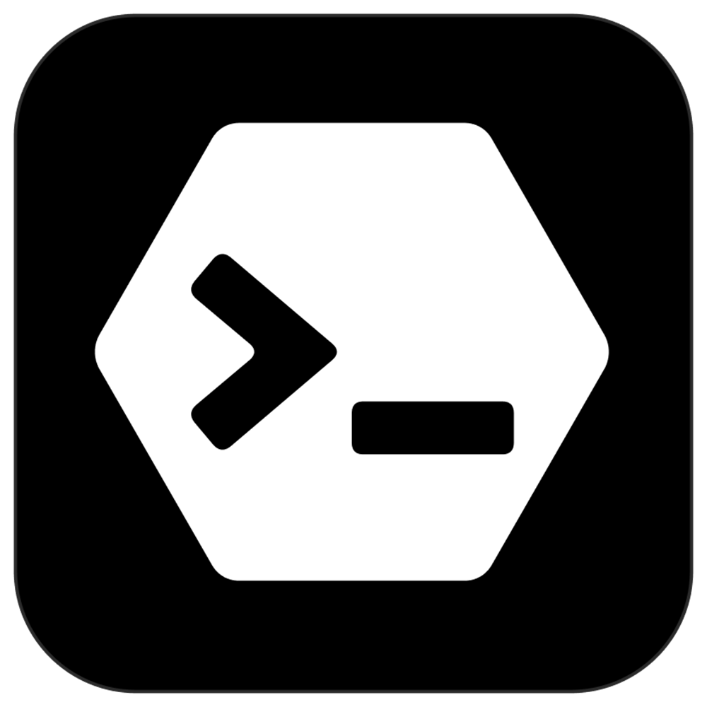

<div align="center">
  
  <h1>Termust</h1>
  <p><strong>Local terminal, SSH and SFTP in one window</strong></p>
  <p><code>Windows x64</code> · <code>Rust 1.92+</code> · <a href="LICENSE">MIT</a></p>
  <p><a href="#english">English</a> · <a href="#русский">Русский</a></p>
</div>

## English

[Quick start](#quick-start) · [SSH](#ssh-sessions) · [SFTP](#sftp-file-transfers) · [Keyboard shortcuts](#keyboard-shortcuts)

### Features

- **Local terminal.** Open PowerShell, CMD and WSL in separate tabs.
- **One-click SSH.** Saved servers stay in the sidebar after you restart Termust.
- **Two-pane SFTP.** Browse server files on the left and local files on the right. Drag files between panes or upload them from File Explorer.

### Quick start

Download `Termust-v0.1.0-windows-x64.exe` from [GitHub Releases](https://github.com/da1loks/termust/releases) and run it.

> [!NOTE]
> SSH and SFTP require the Windows OpenSSH Client. To use the WSL tab, install a WSL distribution.

<details>
<summary>Build from source</summary>

You need Windows x64 with ConPTY and Rust 1.92 or newer with a configured linker. Run these commands from the repository root.

```powershell
cargo build --release --locked
.\target\release\termust.exe
```

</details>

### SSH sessions

1. Click **+ SSH**. Enter an IP address, domain name or alias from `~/.ssh/config`. OpenSSH can supply the username and port from its configuration.
2. Enter your password in **SSH password** (**Пароль SSH**) or specify an SSH key. Click **Open SSH** (**Открыть SSH**) to connect and save the server.
3. To reconnect, click the server name in the sidebar. A saved password or a key available to the SSH agent lets you sign in without entering the password again.

> [!TIP]
> For a one-time connection, clear the **Запомнить SSH-подключение в «Серверах»** checkbox.

<details>
<summary>Edit a profile and find out where passwords are stored</summary>

Click **Save** (**Сохранить**) to save a profile without opening a tab. The **···** menu lets you edit a profile, update its password or forget the saved password.

Profiles are stored in `%LOCALAPPDATA%\termust\profiles.json`. Windows Credential Manager stores passwords. OpenSSH checks the server key using `known_hosts`. Enter one-time passwords (OTP) manually.

</details>

### SFTP file transfers

Click **SFTP** next to a saved server. Double-click a folder to open it, or drop a file directly onto a folder in the other pane. You can drop several files from File Explorer into the left pane at once.

Use **Download →** (**Скачать →**) or **← Upload** (**← Загрузить**) to transfer the selected file. If the destination already contains a file with the same name, Termust keeps the existing file and reports the conflict.

### Keyboard shortcuts

| Shortcut | Action |
| --- | --- |
| Right-click / <kbd>Ctrl</kbd>+<kbd>V</kbd> / <kbd>Ctrl</kbd>+<kbd>Shift</kbd>+<kbd>V</kbd> | Paste into the terminal |
| <kbd>Ctrl</kbd>+<kbd>Shift</kbd>+<kbd>C</kbd> | Copy the selection |
| <kbd>Ctrl</kbd>+<kbd>Shift</kbd>+<kbd>T</kbd> | Open PowerShell |
| <kbd>Ctrl</kbd>+<kbd>Shift</kbd>+<kbd>W</kbd> | Close the tab |
| <kbd>Ctrl</kbd>+<kbd>Tab</kbd> / <kbd>Ctrl</kbd>+<kbd>Shift</kbd>+<kbd>Tab</kbd> | Switch to the next / previous tab |
| <kbd>Shift</kbd>+<kbd>PgUp</kbd> / <kbd>Shift</kbd>+<kbd>PgDn</kbd> | Scroll through terminal history |

| Metric | Result |
| --- | ---: |
| `termust.exe` size | **9.01 MiB** |
| Time to open the window | **192 ms** |
| Memory with one PowerShell tab | **70.6 MiB** |
| CPU time over 5 seconds idle | **0 ms** reported by the process counter |
| Output of 6,500 lines from PowerShell | **659 ms** |

---

## Русский

[Быстрый старт](#быстрый-старт) · [SSH](#ssh) · [SFTP](#sftp) · [Горячие клавиши](#горячие-клавиши)

### Возможности

- **Локальный терминал.** PowerShell, CMD и WSL в отдельных вкладках.
- **SSH в один клик.** Сохранённые серверы доступны в боковой панели после перезапуска.
- **Файлы через SFTP.** Сервер слева, файлы ПК справа. Перетаскивай файлы между панелями или из Проводника на сервер.

### Быстрый старт

Скачай `Termust-v0.1.0-windows-x64.exe` из [GitHub Releases](https://github.com/da1loks/termust/releases) и запусти его.

> [!NOTE]
> Для SSH и SFTP включи компонент Windows «Клиент OpenSSH». Для вкладки WSL нужен установленный дистрибутив.

<details>
<summary>Сборка из исходников</summary>

Нужны Windows x64 с ConPTY и Rust 1.92 или новее с настроенным линкером. Выполни команды из корня проекта.

```powershell
cargo build --release --locked
.\target\release\termust.exe
```

</details>

### Подключения

#### SSH

1. Нажми **+ SSH**. Укажи IP, домен или алиас из `~/.ssh/config`. Пользователя и порт можно взять из настроек OpenSSH.
2. Введи **Пароль SSH** или укажи SSH-ключ. Нажми **Открыть SSH**, чтобы подключиться и сохранить сервер.
3. Чтобы подключиться снова, нажми на имя сервера в боковой панели. Сохранённый пароль или доступный ключ в SSH-агенте позволяют войти без повторного ввода пароля.

> [!TIP]
> Для разового входа сними галочку **Запомнить SSH-подключение в «Серверах»**.

<details>
<summary>Как изменить профиль и где хранится пароль</summary>

Кнопка **Сохранить** добавляет профиль без открытия вкладки. В меню **···** можно изменить профиль, обновить или забыть пароль.

Параметры подключения лежат в `%LOCALAPPDATA%\termust\profiles.json`. Пароль хранит диспетчер учётных данных Windows. OpenSSH проверяет ключ сервера через `known_hosts`. Для входа с OTP используй ручной ввод.

</details>

#### SFTP

Нажми **SFTP** у сохранённого сервера. Открой папку двойным щелчком или перенеси файл прямо на её строку в другой панели. Из Проводника можно перетащить несколько файлов в левую панель за один раз.

Кнопки **Скачать →** и **← Загрузить** копируют выбранный файл. Если имя уже занято, Termust сохраняет существующий файл и показывает ошибку.

### Горячие клавиши

| Клавиши | Действие |
| --- | --- |
| ПКМ / <kbd>Ctrl</kbd>+<kbd>V</kbd> / <kbd>Ctrl</kbd>+<kbd>Shift</kbd>+<kbd>V</kbd> | Вставить в терминал |
| <kbd>Ctrl</kbd>+<kbd>Shift</kbd>+<kbd>C</kbd> | Скопировать выделение |
| <kbd>Ctrl</kbd>+<kbd>Shift</kbd>+<kbd>T</kbd> | Открыть PowerShell |
| <kbd>Ctrl</kbd>+<kbd>Shift</kbd>+<kbd>W</kbd> | Закрыть вкладку |
| <kbd>Ctrl</kbd>+<kbd>Tab</kbd> / <kbd>Ctrl</kbd>+<kbd>Shift</kbd>+<kbd>Tab</kbd> | Следующая / предыдущая вкладка |
| <kbd>Shift</kbd>+<kbd>PgUp</kbd> / <kbd>Shift</kbd>+<kbd>PgDn</kbd> | Прокрутить историю |

| Показатель | Результат |
| --- | ---: |
| Размер `termust.exe` | **9,01 МиБ** |
| Время до появления окна | **192 мс** |
| Память с одной вкладкой PowerShell | **70,6 МиБ** |
| Процессорное время за 5 с простоя | **0 мс** по счётчику процесса |
| Вывод 6 500 строк из PowerShell | **659 мс** |
